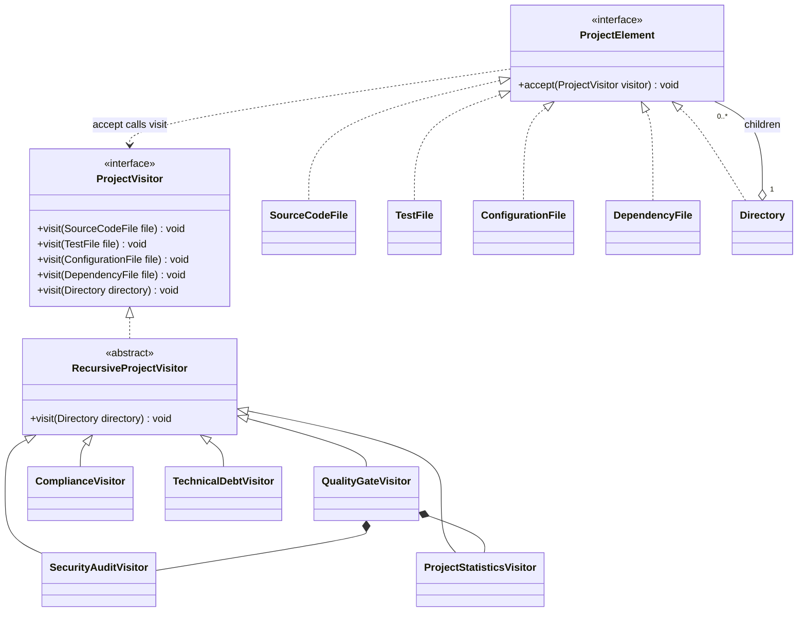

# Smart Code Inspection and Compliance Engine

Assignment 6 for Software Design Patterns. Author: **Artem Khloptsev (Артем Хлоцев)**.
Java 17, Maven and JUnit 5. The project uses Visitor to inspect the same immutable
project tree with independent security, statistics, quality, compliance and technical debt operations.

## Build and run

Open **this folder**, containing `pom.xml`, as a Maven project in IntelliJ IDEA and select JDK 17+.
Run `edu.assignment.inspection.Main`, or use:

```shell
mvn clean verify
java -jar target/smart-code-inspection-1.0.0.jar
```

Windows demo without Maven (requires a JDK, not only a JRE):

```powershell
.\run.ps1
```

`run.ps1` compiles and runs production code; JUnit tests require Maven.
A prebuilt Java 17 executable is included at `dist/smart-code-inspection-1.0.0.jar`.
Run it with `java -jar dist/smart-code-inspection-1.0.0.jar`.

## Project structure and demo

```text
src/main/java/edu/assignment/inspection/
  model/       ProjectElement, five concrete elements, Dependency
  visitor/     ProjectVisitor, RecursiveProjectVisitor, five concrete visitors
  report/      Immutable reports, issues, severity and quality policy
  demo/        DemoProjects and ConsoleReporter
  Main.java
src/test/java/edu/assignment/inspection/
docs/          UML, defense notes and verification evidence
```

`DemoProjects.fintechProject()` builds this in-memory tree:

```text
fintech-project/
|-- src/
|   |-- PaymentService.java
|   `-- UserService.java
|-- tests/
|   `-- PaymentServiceTest.java
|-- config/
|   `-- application.properties
`-- pom.xml
```

These are model objects with supplied metadata. The application does not parse a real
repository, run its tests, calculate complexity from an AST or consult a vulnerability database.
Dependency identifiers and vulnerability flags in the risky sample are educational fixtures.
Every visitor receives the **same** `Directory` object. A second, corrected tree demonstrates success.

| Metric | fintech-project | fintech-project-fixed |
| --- | --- | --- |
| Files | 5 | 6 |
| Lines of code | 374 | 424 |
| Source files / test files | 2 / 1 | 2 / 2 |
| Test methods | 6 | 10 |
| Dependency declarations | 3 | 1 |
| Average source complexity | 10.00 | 6.50 |
| Test/source file ratio | 0.50 | 1.00 |
| Critical security issues | 3 | 0 |
| Security score | 0/100 | 100/100 |
| Quality gate | FAILED | PASSED |
| Compliance violations | 5 | 0 |
| Estimated technical debt | 285 minutes | 0 minutes |

See [complete console output](docs/demo-output.txt).

## Architecture and double dispatch

**Element** is `model.ProjectElement`, exposing `void accept(ProjectVisitor visitor)`.
`SourceCodeFile`, `TestFile`, `ConfigurationFile`, `DependencyFile` and `Directory`
implement it. Their records contain validated data, with defensive copies of lists.
They contain no audit, compliance or release logic.

**Visitor** is `visitor.ProjectVisitor`, with one overloaded `visit` for each of the five types.
`RecursiveProjectVisitor` provides default leaf methods and directory traversal.
The five concrete visitors extend it and override only the operations they need.

When `ProjectElement element = paymentFile` receives `element.accept(visitor)`, Java first
dispatches to `SourceCodeFile.accept`. Inside that method, the compile-time type of `this`
is `SourceCodeFile`, so overload resolution selects `visit(SourceCodeFile)`. Dynamic dispatch
then selects that method on the actual visitor, such as `SecurityAuditVisitor`.
The result depends on both the element type and visitor type: **double dispatch**.
Calling `visit(element)` through a `ProjectElement` reference alone cannot select these overloads.

Each `accept` only calls `visitor.visit(this)`. Traversal belongs to
`RecursiveProjectVisitor.visit(Directory)`, which calls `child.accept(this)` exactly once per child.
Elements never walk children themselves, preventing accidental duplicate visits.
`QualityGateVisitor` forwards each leaf to its internal security/statistics visitors;
it does not forward a whole directory and then traverse it again.
No element classification uses `instanceof`, reflection or a type switch.

## Visitor rules and metrics

**SecurityAuditVisitor** detects hardcoded source credentials and exposed configuration
credentials (CRITICAL), vulnerable dependencies (CRITICAL), high-risk source files and
disabled encrypted transport (HIGH), and debug configuration (MEDIUM).
The score is `max(0, 100 - sum(penalties))`; penalties are 25, 15 and 5 respectively.
Every report identifies the rule, element, severity and suggested action.

**ProjectStatisticsVisitor** counts all leaf files, including configuration and dependency
manifests, and sums their declared lines. Directories are excluded. Dependencies are counted
as declarations across manifests, without deduplication. Average complexity is the arithmetic
mean over source files only. The test/source ratio is **test file count / source file count**,
not test coverage or test method count. A project without sources has ratio and average 0.
Totals use `long` to avoid overflow when adding large `int` metrics.

**QualityGateVisitor** passes when there is at least one source file, critical security issues
equal 0, average complexity is at most 10, and test/source file ratio is at least 0.40.
Exact boundary values pass. Empty projects fail. Thresholds can be injected with `QualityPolicy`.
HIGH/MEDIUM security issues affect the security score but do not fail the critical-issue gate.
Compliance is reported separately. A quality PASS therefore does not imply compliance PASS.

**ComplianceVisitor** rejects exposed credentials, dependencies with blank versions,
prohibited dependency coordinates, and production modules without a nonempty test file.
The default prohibited coordinate is `com.legacy:unsafe-crypto`; inject another set through
the constructor. A test belongs to a module through its explicit `module` value.
Tests from another module, and files with zero test methods, do not satisfy the rule.
Cross-file checks run when `report()` is requested, making traversal order irrelevant.
Multiple source files in the same module produce at most one missing-tests violation.

**TechnicalDebtVisitor** was added after the four required visitors in its own commit,
without changing the element classes or `ProjectVisitor` interface.
It estimates 30 minutes for each source complexity point above 10, 60 minutes per source
with hardcoded credentials, 45 minutes per high-risk source, and 120 minutes per untested
production module. These are transparent planning heuristics, not measured engineering time.

Visitors accumulate results during one traversal. Create fresh instances for another analysis;
reusing one intentionally adds another traversal's data. Visitors are not thread-safe.
Report collections are immutable snapshots and repeated `report()` calls do not add findings.
The tree is immutable and acyclic by construction. Shared leaf references are counted once
per occurrence. Traversal is O(elements + dependency declarations), with O(depth) call stack;
very large depths can overflow the JVM stack. An explicit stack would be preferable for an
untrusted or unbounded-depth filesystem importer. A 256-level nested tree is covered by tests.

## UML

[Class diagram](docs/class-diagram.svg) and [sequence diagram](docs/sequence-diagram.svg)
show the implemented types and dispatch calls. Editable PlantUML sources are provided
alongside the SVGs. The class diagram focuses on the Visitor roles and omits report fields.



## Questions for the defense

**What problem does Visitor solve?** It separates operations from the project elements.
One stable tree can be processed by new audits without collecting unrelated methods in each file class.

**Why not put operations in every element?** Adding an audit would require editing every
element. Security and business rules would become mixed with data and traversal, increasing coupling.

**Is a new Visitor or a new Element easier?** A new visitor is easier: implement the existing
interface (or extend the recursive base), add tests, and invoke it. Existing elements stay unchanged.

**What if we add DatabaseMigrationFile?** Add a class implementing `ProjectElement`, with
`accept` calling `visitor.visit(this)`. Add `void visit(DatabaseMigrationFile file)` to
`ProjectVisitor`. Add a default overload to `RecursiveProjectVisitor`, then review **every**
concrete visitor for migration semantics. Statistics should count its lines; security should inspect
dangerous SQL/credentials; compliance should define migration rules; quality must forward this
new leaf to its internal visitors; debt may estimate migration risk. Direct implementations of
`ProjectVisitor` must implement the new method or fail compilation. Inheriting the base no-op
avoids that compiler error but can silently omit required logic, so the semantic review is essential.
Existing concrete element classes do not change. Update factories/importers, both UML diagrams
where relevant, and dispatch/rule tests. Adding the element before the interface overload makes
`visit(this)` fail to compile. Adding it only to the interface breaks nonabstract implementers.

**When is Visitor a bad choice?** When element types change frequently, there are very few
operations, or an operation needs access to private state that would force excessive getters.
Visitor makes adding new element types costly and couples the interface to concrete elements.

**Visitor versus Strategy?** Strategy swaps an algorithm behind one operation, such as choosing
the fastest or cheapest delivery route. Visitor introduces operations over several known element
types and uses double dispatch. It is useful here because security, statistics and compliance all
need different behavior for the same collection of file types.

**Which SOLID principles appear?** SRP separates data, traversal, rules and presentation.
OCP supports new operations without editing existing elements, but adding element types is the
explicit limitation. DIP makes elements depend on the `ProjectVisitor` abstraction and traversal
depend on `ProjectElement`. LSP lets all five elements participate in the same tree contract.
The visitor interface intentionally depends on concrete types; its five overloads must be considered
together, so this is not a claim that Visitor perfectly satisfies ISP in every application.

**What if accept is removed?** The common dispatch entry point disappears. A caller holding
`ProjectElement` cannot select an overload for its runtime subtype. Restoring it avoids type checks.

For Russian walkthroughs and live modification steps, see [defense notes](docs/DEFENSE_RU.md).

## Tests and requirements

Run `mvn clean verify`. The suite contains meaningful JUnit 5 tests of:

| Requirement | Main evidence |
| --- | --- |
| Five concrete types and double dispatch | `ElementTest` |
| Nested and empty directories, immutable children | `ElementTest`, `TraversalEdgeCaseTest` |
| Credentials, configuration and dependency security | `SecurityAuditVisitorTest` |
| File, line, test, dependency and complexity statistics | `ProjectStatisticsVisitorTest` |
| Quality PASS/FAIL and exact thresholds | `QualityGateVisitorTest` |
| Dependency versions, prohibited libraries, module tests | `ComplianceVisitorTest` |
| Separate fifth visitor and arithmetic edge cases | `TechnicalDebtVisitorTest` |
| Same tree, corrected tree and console output | `DemoIntegrationTest` |
| Class and sequence UML | `docs/*.puml`, `docs/*.svg` |
| Visitor limitation and conceptual questions | This README and `docs/DEFENSE_RU.md` |
| Gradual development and separate extra visitor | `git log --reverse --oneline` (10 commits) |

[Verification record](docs/verification.txt) records the final local build and test results.
To submit, use the public GitHub repository and upload this README (or its PDF export) to Moodle.
The individual defense and unexpected live modification are performed by the student.
